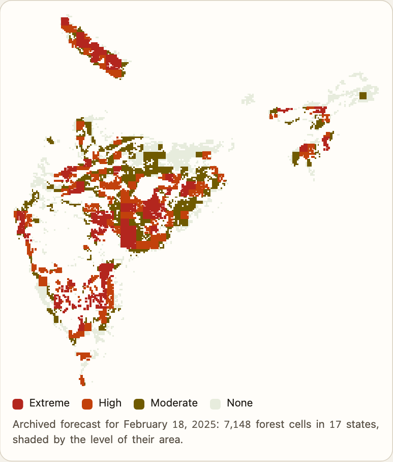
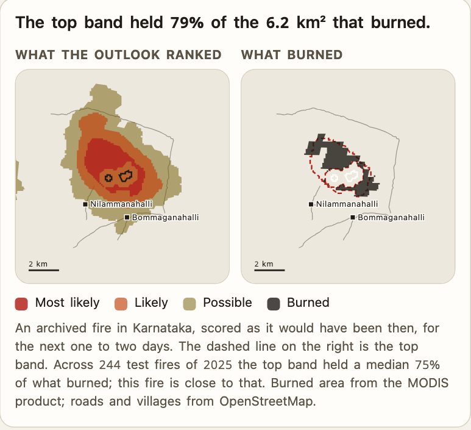

<picture>
  <source media="(prefers-color-scheme: dark)" srcset="https://raw.githubusercontent.com/terra-watch/dashboard/main/frontend/public/brand/logo-on-dark.svg">
  
</picture>

**See where wildfire is likely tomorrow, and where a fire will go next.**

Forest fire forecast, spread outlook and monitoring for India's forests, for rangers and control-room staff.

English · हिन्दी · ଓଡ଼ିଆ

[Website](https://terra-watch-tawny.vercel.app) · [Dataset](https://zenodo.org/records/23647151)

---

## Forecast: where fire is likely tomorrow

<table>
<tr>
<td width="52%" valign="top">

Each 55 km forest area of 17 states gets a level for the next day: **None, Moderate (10%), High (30%) or Extreme (60%)**, with the places to look first. A gradient-boosted model scores 7,148 forest cells from NASA VIIRS detections, ERA5-Land and GFS weather, terrain and each area's own fire history. Kilns, mines and other heat that is not forest fire are removed before the model learns.

On the held-out year 2025 it reaches an average precision of **0.519 per cell and 0.795 per area**, against 0.292 for climatology. Areas rated Extreme had a detected fire on **81%** of area-days. Yesterday's forecast is shown beside what was detected.

</td>
<td width="48%" valign="top">

</td>
</tr>
</table>

## Outlook: where a burning fire goes next

<table>
<tr>
<td width="48%" valign="top">

</td>
<td width="52%" valign="top">

Pick a burning fire and see the forest cells within 8 km ranked in three bands for the **next one to two days**. A gated U-Net, trained on **2,930 past fires in 25 states**, reads 46 layers (terrain, fuel, weather, the fire's own detections) on a 192 × 192 grid of 100 m cells.

On **244 test fires of 2025** the top band held a **median 75%** of the cells that burned; nearest-first ranking holds 50%. The same holds on three states the model never saw. It ranks where a fire spreads, not when. The labels come from the MODIS burned-area product.

</td>
</tr>
</table>

## Monitoring: what is burning or happening now

<table>
<tr>
<td width="48%" valign="top">

</td>
<td width="52%" valign="top">

**Satellite detections.** Every VIIRS detection is kept and sorted into likely fire, unconfirmed, known heat source (mine, kiln or power plant within 1 km) or outside forest, with the reason in words. A classifier scores the chance that a burn scar follows within 1 km. Nothing is hidden; each group can be switched on.

**Active fires.** Detections within 1 km and 36 hours form one fire, with its size, growth, the side it grew toward and the nearest named villages. A board orders fires by who needs attention.

**Lookout stations.** Fixed ESP32-S3 stations read fine particles, temperature and humidity, and listen with a sound classifier for chainsaws and blasts. Each reading is judged against that station's own normal and its neighbours. Stations relay through each other over LoRa; in simulation 95 to 98% of reports still arrive after the busiest relay fails. A station never confirms a fire; only a ranger does.

</td>
</tr>
</table>

## Software suggests, people decide

A model never verifies, assigns, dispatches or announces. A control-room user sends a crew as a check; a ranger accepts, visits and records what they find (confirmed, not confirmed, inconclusive), also offline. Official notices are written by one person and approved by a second. Citizens can send a report with place, time and photos; stored photos lose their location data and faces in public copies are blurred. Access is limited by state on the server and every state change is written to an audit log. A missing dot on a map is never evidence that there is no fire, and the views say so.

The demonstration replays archived days of 2025 beside the fires that were actually detected.

## Repositories

| Repository | Content |
|---|---|
| [dashboard](https://github.com/Terra-Watch/dashboard) | The web application: backend, frontend, tests |
| [wildfire-ignition-forecasting](https://github.com/Terra-Watch/wildfire-ignition-forecasting) | The next-day forecast: data build, models, calibration |
| [fire-spread-model](https://github.com/Terra-Watch/fire-spread-model) | The spread outlook: cases, models, notebooks |
| [acoustic-ml](https://github.com/Terra-Watch/acoustic-ml) | The sound classifier for the stations |
| [node-firmware](https://github.com/Terra-Watch/node-firmware) | Station firmware: sensors, routing, packets |
| [relay-firmware](https://github.com/Terra-Watch/relay-firmware) | Relay firmware for the LoRa mesh |
| [gateway-firmware](https://github.com/Terra-Watch/gateway-firmware) | Gateway firmware and the bridge to the server |
| [terrawatch-datasets](https://github.com/Terra-Watch/terrawatch-datasets) | Data catalog and bucket paths for all datasets |

## Data sources

NASA FIRMS (VIIRS) for detections · ERA5-Land, Open-Meteo and NOAA GFS for weather · MODIS burned area and Sentinel-2 for what burned · OpenStreetMap contributors for the basemap and named places · rangers' field observations for evidence.
