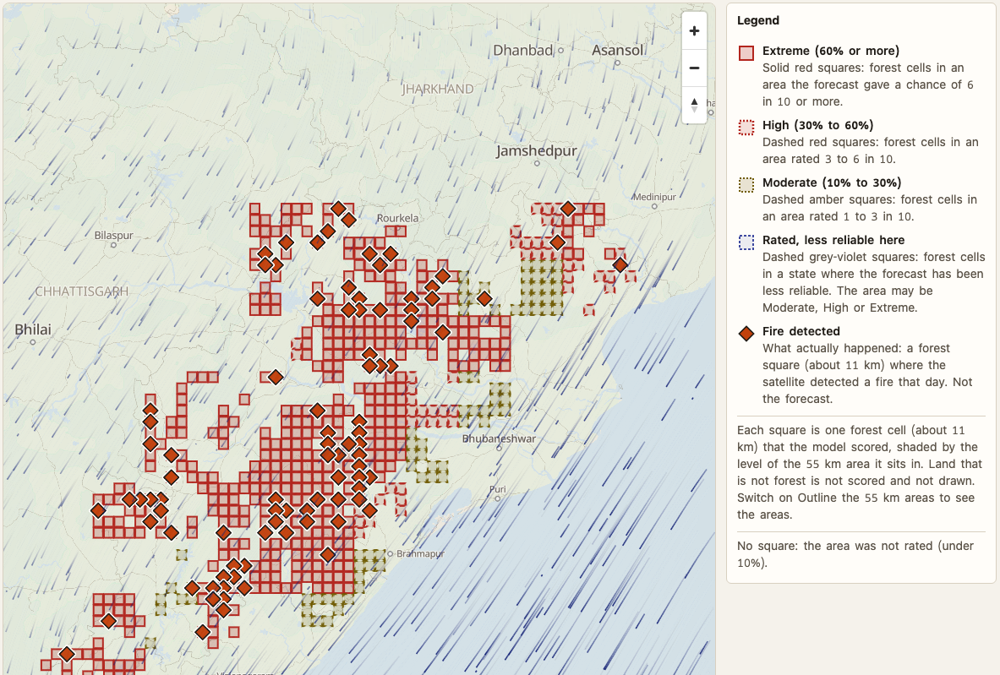
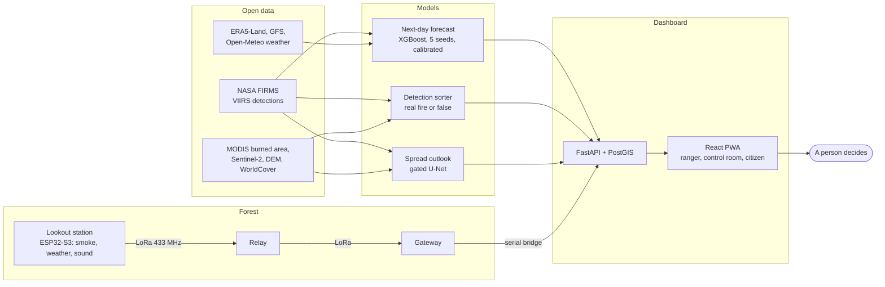
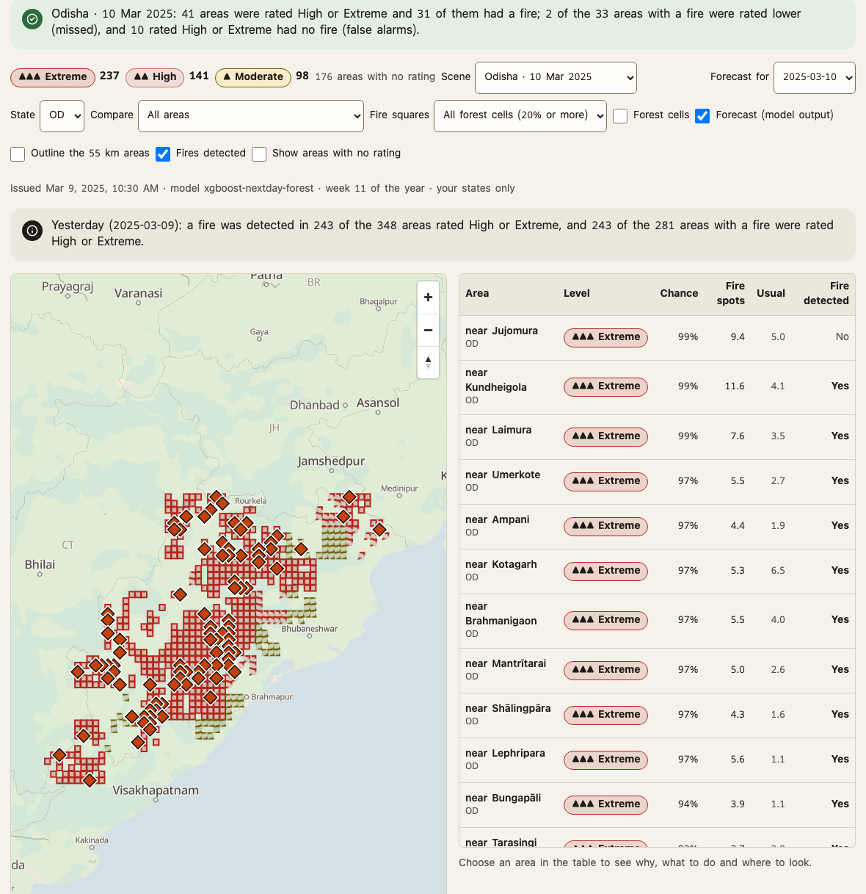
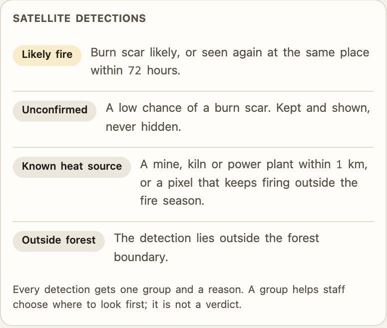

<picture>
  <source media="(prefers-color-scheme: dark)" srcset="https://raw.githubusercontent.com/terra-watch/dashboard/main/frontend/public/brand/logo-on-dark.svg">
  
</picture>

### See where wildfire is likely tomorrow, and where a fire will go next.

Forest fire **forecast**, **spread outlook** and **monitoring** for India's forest departments. 
Three models, a web application in three languages, and a LoRa network of lookout stations.

[**Live site**](https://terra-watch-tawny.vercel.app) &nbsp;·&nbsp; [**Dataset on Zenodo**](https://zenodo.org/records/23647151) &nbsp;·&nbsp; [Dashboard code](https://github.com/Terra-Watch/dashboard) &nbsp;·&nbsp; English · हिन्दी · ଓଡ଼ିଆ

The control-room map for Odisha, 10 March 2025. Squares are forest cells shaded by the forecast level; diamonds are the fires the satellite detected that day.

---

## In numbers

| | | |
|:---|:---|:---|
| **7,148** forest cells in **17 states** scored every day | **0.795** average precision per 55 km area on the unseen year 2025 | **81%** of area-days rated Extreme had a detected fire |
| **2,930** past fires in 25 states train the spread model | **75%** of what burned lies inside the top band (median, 244 test fires) | **50%** is what ranking the nearest cells first gets |
| **43,055** sound clips train the station classifier | **4.3 MB** int8 model runs on an ESP32-S3 in **1.85 s** | **97 to 99%** of station reports arrive in an 80-station simulation |

The forecast and outlook numbers come from data the models never saw in training: the year 2025, and three states held out completely. The station numbers are from the bench and a simulation, not from a forest.

## How it fits together

Software suggests and people decide. A model never verifies, assigns, dispatches or announces. Anything that becomes an action goes through a ranger or a control-room user.

---

## 1. Forecast: where fire is likely tomorrow

<table>
<tr>
<td width="50%" valign="top">

</td>
<td width="50%" valign="top">

Each 55 km forest area gets a chance of a satellite-detected fire for the next day, shown as a level with the places to look first.

| Level | Chance | Area-days that had a fire (2025) |
|---|---|---|
| Extreme | 60% or more | **81%** |
| High | 30 to 60% | **42%** |
| Moderate | 10 to 30% | **17%** |
| None | under 10% | 0.7% |

**Model.** XGBoost, five seeds, isotonic calibration. 41 daily inputs per cell: fire history, ERA5-Land weather, the GFS forecast, NDVI, land cover, terrain, people and roads.

**Tested on 2025.** Average precision 0.519 per cell against 0.292 for climatology, 0.227 for persistence and 0.116 for the Fire Weather Index. Nine model families were compared, from logistic regression to a graph network; on the test year none did better than boosted trees.

**Honest about misses.** The board sets yesterday's forecast beside what was detected: on the day shown, 41 areas were rated High or Extreme, 31 had a fire, and 2 fires were missed.

Code: [wildfire-ignition-forecasting](https://github.com/Terra-Watch/wildfire-ignition-forecasting)

</td>
</tr>
</table>

## 2. Outlook: where a burning fire goes next

<table>
<tr>
<td width="50%" valign="top">

Pick a burning fire and see the forest cells within 8 km ranked in three bands for the **next one to two days**, with the villages, people and roads in each band.

**Model.** A gated U-Net reads 46 map layers on a 192 × 192 grid of 100 m cells (the fire's detections, fuel, terrain, Sentinel-2, burn history) and 31 numbers of weather and fire size.

**Tested on fires it never saw.**

| | Model | Nearest-first |
|---|---|---|
| Direction AUC, 250 test fires of 2025 | **0.792** | 0.600 |
| Direction AUC, 3 held-out states | **0.818** | 0.595 |
| Burned cells inside the top band (median) | **75%** | 50% |

**What it is not.** It ranks where a fire spreads, not when, and it is shown on archived fires. Live scoring is not built yet.

Code: [fire-spread-model](https://github.com/Terra-Watch/fire-spread-model)

</td>
<td width="50%" valign="top">

</td>
</tr>
</table>

## 3. Monitoring: what is burning or happening now

<table>
<tr>
<td width="46%" valign="top">

</td>
<td width="54%" valign="top">

**Satellite detections, sorted.** Every VIIRS detection is kept and put in one of four groups with the reason in words. A classifier scores the chance that a burn scar follows within 1 km. Nothing is hidden.

**Active fires.** Detections within 1 km and 36 hours become one fire with its size, growth, the side it grew toward and the nearest named villages. A board orders fires by who needs attention.

**Lookout stations.** ESP32-S3 stations read PM2.5, temperature and humidity every 15 s, and an on-device classifier listens for chainsaws and blasts. Reports hop station to relay to gateway over LoRa at 433 MHz, with listen-before-talk, a backup parent and an end-to-end receipt for alerts. Each reading is judged against that station's own normal and its neighbours.

A station never confirms a fire. Only a ranger on the ground does.

Code: [node-firmware](https://github.com/Terra-Watch/node-firmware) · [relay-firmware](https://github.com/Terra-Watch/relay-firmware) · [gateway-firmware](https://github.com/Terra-Watch/gateway-firmware) · [acoustic-ml](https://github.com/Terra-Watch/acoustic-ml)

</td>
</tr>
</table>

---

## Who uses it

| Role | What they do |
|---|---|
| **Ranger** | Reads tomorrow's forecast for their area and the fires near them, accepts an assignment, records what they find (confirmed, not confirmed, inconclusive). Works offline. |
| **Control room** | Works the forecast board, the satellite and active-fire boards and the map, sends a crew, closes checks, publishes notices approved by a second person. |
| **Admin** | Manages accounts, stations and access by state. |
| **Citizen** | Sends a report with place, time and photos, and reads notices. Stored photos lose their location data and faces in public copies are blurred. |

## Built with

 

 

## Repositories

| Repository | What it holds | Stack |
|---|---|---|
| [**dashboard**](https://github.com/Terra-Watch/dashboard) | The web application: forecast board, satellite and active-fire boards, map, field work, notices, citizen reports. 662 backend tests and 130 browser tests. | React 19, TypeScript, MapLibre, FastAPI, PostGIS |
| [**wildfire-ignition-forecasting**](https://github.com/Terra-Watch/wildfire-ignition-forecasting) | The next-day forecast: nine model families, frozen evaluation protocol, calibration, the daily scoring job. | XGBoost, PyTorch, scikit-learn |
| [**fire-spread-model**](https://github.com/Terra-Watch/fire-spread-model) | The spread outlook: 2,930 fire cases, five image models, the check against what burned. | PyTorch, rasterio, numba |
| [**acoustic-ml**](https://github.com/Terra-Watch/acoustic-ml) | The station sound classifier: corpus, training, int8 export, speed test on the chip. | PyTorch, timm, TFLite |
| [**node-firmware**](https://github.com/Terra-Watch/node-firmware) | Station firmware: sensors, sound, the v5 radio protocol, multi-hop routing, the network simulation. | C++, PlatformIO, ESP32-S3 |
| [**relay-firmware**](https://github.com/Terra-Watch/relay-firmware) | Relay build that forwards station packets toward the gateway. | C++, PlatformIO, ESP32 |
| [**gateway-firmware**](https://github.com/Terra-Watch/gateway-firmware) | The LoRa receiver at the root of the network and its serial output for the bridge. | C++, PlatformIO, ESP32-S3 |
| [**terrawatch-datasets**](https://github.com/Terra-Watch/terrawatch-datasets) | The data catalog: every dataset, its schema, a sample and where it is stored. | Python, Parquet |

## Data sources

| Source | Used for |
|---|---|
| [NASA FIRMS](https://firms.modaps.eosdis.nasa.gov/) VIIRS 375 m | Fire detections: labels, fire history, active fires |
| [ERA5-Land](https://cds.climate.copernicus.eu/), [NOAA GFS](https://www.ncei.noaa.gov/products/weather-climate-models/global-forecast), [Open-Meteo](https://open-meteo.com/) | Weather and the weather forecast |
| MODIS MCD64A1 burned area, Sentinel-2 | What burned: spread labels and the detection sorter |
| Copernicus DEM, ESA WorldCover, WorldPop | Terrain, land cover, people |
| [OpenStreetMap](https://www.openstreetmap.org/copyright) contributors | Basemap, roads, named places |

## What is not done yet

- The spread outlook runs on archived fires. Scoring live fires is planned, not built.
- The stations are built and simulated. The radio link has not been range-tested in a forest, and the sound thresholds are not calibrated in the field.
- The sound classifier raises far more false alarms on unseen forest recordings than the target of one per hour.
- A missing dot on a map is never evidence that there is no fire, and every view says so.
